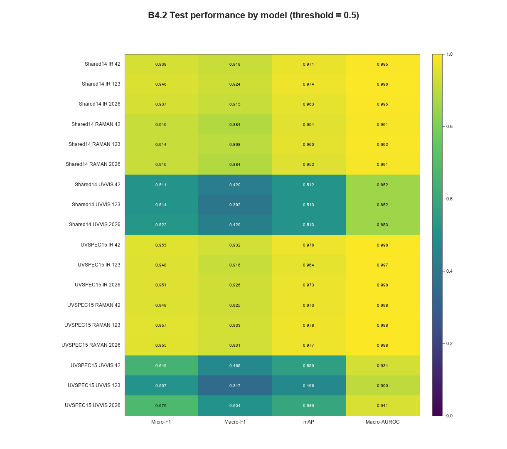
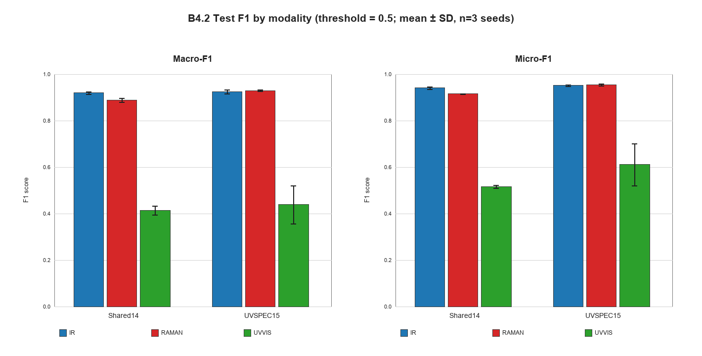
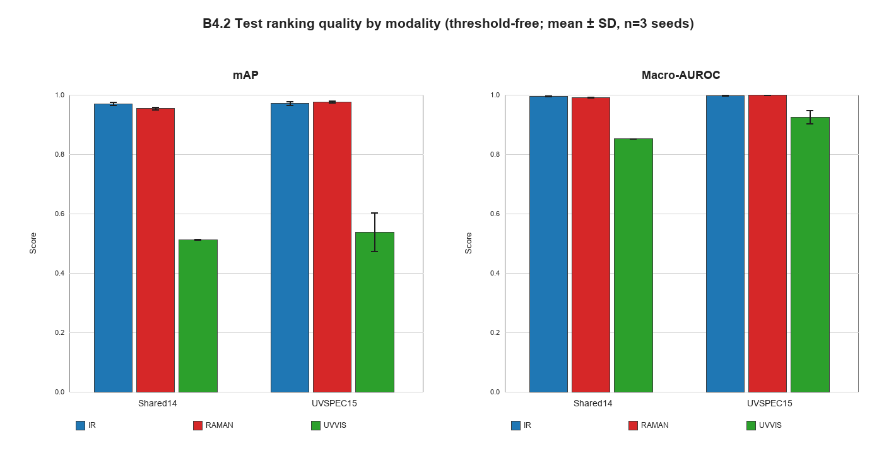
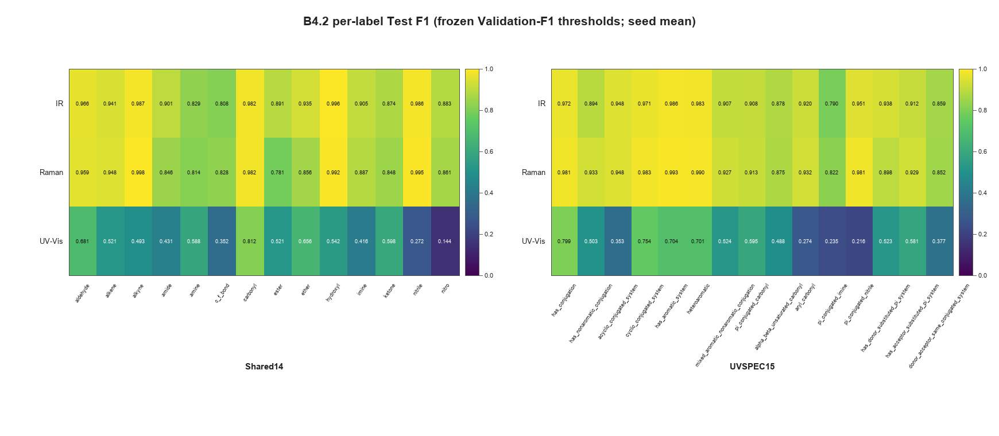
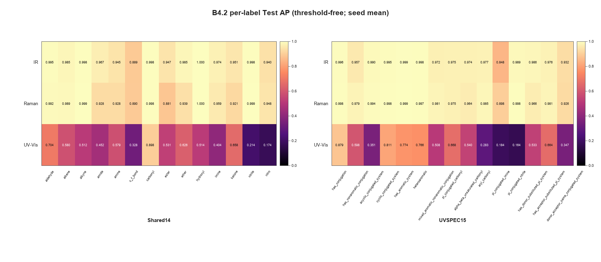
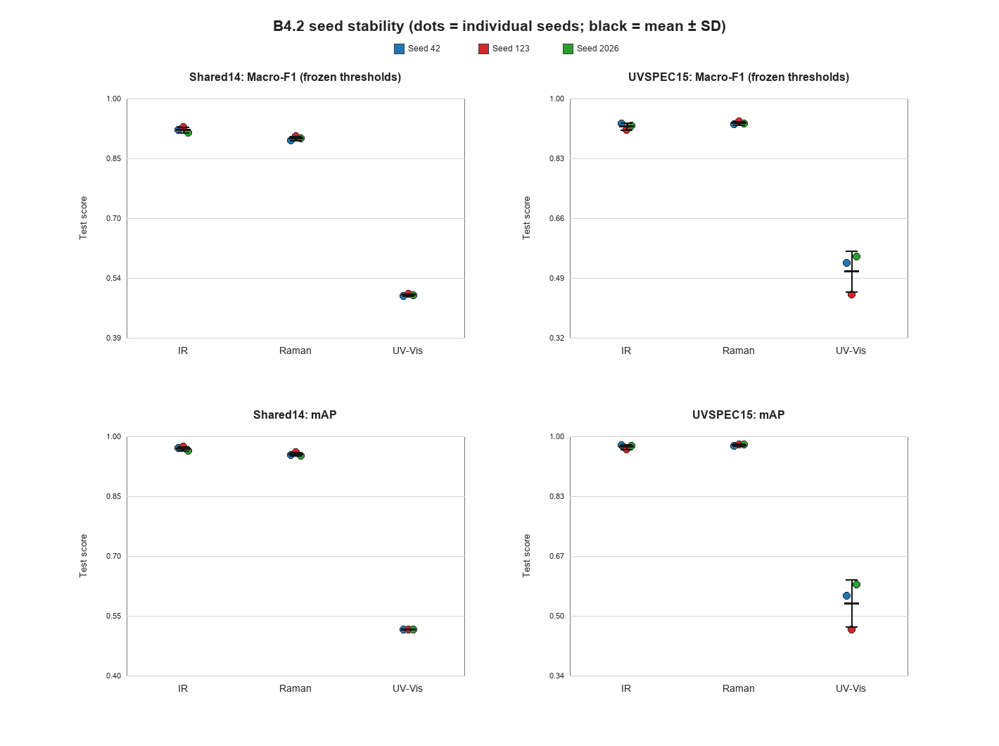
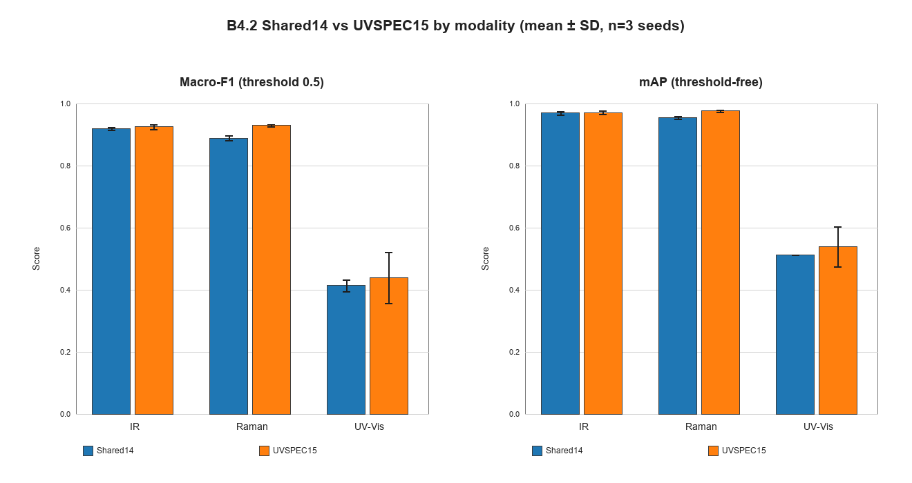

# Line B B4.2 — Test Performance Evaluation & Modality Comparison

> **Classification: exploratory / post-hoc.** The Test split was opened before B4; results are not a blind test and must not be presented as confirmatory.

- FREEZE: `runs\LINE-B-MANIFESTS\FREEZE.json` (SHA256 `65a84959356a9a1f7a6e1d6434449f607c75a4c224a17450f3345ba25bb92a0c`), protocol `B0 v0.2` `713fa92f5fd1f2134c1512bd2e49f689433a2158d120e41c9460ff5c287dd46a`
- Test predictions: `runs\LINE-B-TEST-PREDICTIONS` (18 models, 12,981 rows each)
- Test access log: `runs\LINE-B-MANIFESTS\test_access_log.json` (SHA256 `e7b0bd49dccf816504afcca1438755e2cc82522f4dda688d6b20c5afc740580a`, 18 entries)
- Threshold policies: **primary F1 = fixed 0.5** (B0 §6.2); **secondary F1 = frozen per-label Validation-F1**; AP/AUROC are threshold-free.
- All metrics are recomputed from the frozen FP32 Test probability arrays. No Test threshold fitting, no calibration refit, no Bootstrap.

## 1. Overall Test metrics (per model)

### 1.1 Primary F1 policy (fixed 0.5)

| Task | Modality | Seed | Micro-F1 | Macro-F1 | mAP | Macro-AUROC | n_AP |
|---|---|---|---|---|---|---|---|
| Shared14 | IR | 42 | 0.9385 | 0.9184 | 0.9705 | 0.9954 | 14 |
| Shared14 | IR | 123 | 0.9459 | 0.9245 | 0.9744 | 0.9963 | 14 |
| Shared14 | IR | 2026 | 0.9372 | 0.9148 | 0.9634 | 0.9947 | 14 |
| Shared14 | RAMAN | 42 | 0.9155 | 0.8838 | 0.9538 | 0.9908 | 14 |
| Shared14 | RAMAN | 123 | 0.9137 | 0.8976 | 0.9599 | 0.9916 | 14 |
| Shared14 | RAMAN | 2026 | 0.9162 | 0.8838 | 0.9517 | 0.9910 | 14 |
| Shared14 | UVVIS | 42 | 0.5115 | 0.4204 | 0.5118 | 0.8525 | 14 |
| Shared14 | UVVIS | 123 | 0.5141 | 0.3922 | 0.5131 | 0.8519 | 14 |
| Shared14 | UVVIS | 2026 | 0.5220 | 0.4288 | 0.5126 | 0.8527 | 14 |
| UVSPEC15 | IR | 42 | 0.9546 | 0.9320 | 0.9759 | 0.9980 | 15 |
| UVSPEC15 | IR | 123 | 0.9481 | 0.9157 | 0.9639 | 0.9972 | 15 |
| UVSPEC15 | IR | 2026 | 0.9510 | 0.9258 | 0.9729 | 0.9979 | 15 |
| UVSPEC15 | RAMAN | 42 | 0.9491 | 0.9253 | 0.9728 | 0.9979 | 15 |
| UVSPEC15 | RAMAN | 123 | 0.9569 | 0.9326 | 0.9785 | 0.9984 | 15 |
| UVSPEC15 | RAMAN | 2026 | 0.9553 | 0.9307 | 0.9768 | 0.9982 | 15 |
| UVSPEC15 | UVVIS | 42 | 0.6461 | 0.4650 | 0.5591 | 0.9343 | 15 |
| UVSPEC15 | UVVIS | 123 | 0.5072 | 0.3473 | 0.4656 | 0.9002 | 15 |
| UVSPEC15 | UVVIS | 2026 | 0.6790 | 0.5036 | 0.5893 | 0.9413 | 15 |

### 1.2 Secondary F1 policy (frozen per-label Validation-F1 thresholds)

| Task | Modality | Seed | Micro-F1 | Macro-F1 | mAP | Macro-AUROC | n_AP |
|---|---|---|---|---|---|---|---|
| Shared14 | IR | 42 | 0.9331 | 0.9200 | 0.9705 | 0.9954 | 14 |
| Shared14 | IR | 123 | 0.9427 | 0.9274 | 0.9744 | 0.9963 | 14 |
| Shared14 | IR | 2026 | 0.9346 | 0.9134 | 0.9634 | 0.9947 | 14 |
| Shared14 | RAMAN | 42 | 0.9124 | 0.8944 | 0.9538 | 0.9908 | 14 |
| Shared14 | RAMAN | 123 | 0.9173 | 0.9049 | 0.9599 | 0.9916 | 14 |
| Shared14 | RAMAN | 2026 | 0.9124 | 0.9000 | 0.9517 | 0.9910 | 14 |
| Shared14 | UVVIS | 42 | 0.5786 | 0.4998 | 0.5118 | 0.8525 | 14 |
| Shared14 | UVVIS | 123 | 0.5674 | 0.5041 | 0.5131 | 0.8519 | 14 |
| Shared14 | UVVIS | 2026 | 0.5754 | 0.5018 | 0.5126 | 0.8527 | 14 |
| UVSPEC15 | IR | 42 | 0.9538 | 0.9296 | 0.9759 | 0.9980 | 15 |
| UVSPEC15 | IR | 123 | 0.9453 | 0.9103 | 0.9639 | 0.9972 | 15 |
| UVSPEC15 | IR | 2026 | 0.9504 | 0.9237 | 0.9729 | 0.9979 | 15 |
| UVSPEC15 | RAMAN | 42 | 0.9519 | 0.9266 | 0.9728 | 0.9979 | 15 |
| UVSPEC15 | RAMAN | 123 | 0.9575 | 0.9358 | 0.9785 | 0.9984 | 15 |
| UVSPEC15 | RAMAN | 2026 | 0.9544 | 0.9291 | 0.9768 | 0.9982 | 15 |
| UVSPEC15 | UVVIS | 42 | 0.6456 | 0.5331 | 0.5591 | 0.9343 | 15 |
| UVSPEC15 | UVVIS | 123 | 0.5789 | 0.4421 | 0.4656 | 0.9002 | 15 |
| UVSPEC15 | UVVIS | 2026 | 0.6690 | 0.5503 | 0.5893 | 0.9413 | 15 |

## 2. Modality comparison (3-seed mean ± sample SD)

### Primary policy: fixed 0.5

| Task | Modality | Micro-F1 | Macro-F1 | mAP | Macro-AUROC |
|---|---|---|---|---|---|
| Shared14 | IR | 0.9405 ± 0.0047 | 0.9192 ± 0.0049 | 0.9695 ± 0.0056 | 0.9955 ± 0.0008 |
| Shared14 | RAMAN | 0.9151 ± 0.0013 | 0.8884 ± 0.0080 | 0.9551 ± 0.0043 | 0.9911 ± 0.0004 |
| Shared14 | UVVIS | 0.5159 ± 0.0055 | 0.4138 ± 0.0192 | 0.5125 ± 0.0007 | 0.8524 ± 0.0004 |
| UVSPEC15 | IR | 0.9512 ± 0.0033 | 0.9245 ± 0.0083 | 0.9709 ± 0.0063 | 0.9977 ± 0.0004 |
| UVSPEC15 | RAMAN | 0.9538 ± 0.0041 | 0.9295 ± 0.0038 | 0.9760 ± 0.0029 | 0.9982 ± 0.0002 |
| UVSPEC15 | UVVIS | 0.6108 ± 0.0912 | 0.4386 ± 0.0814 | 0.5380 ± 0.0645 | 0.9252 ± 0.0220 |

### Secondary policy: frozen Validation-F1

| Task | Modality | Micro-F1 | Macro-F1 | mAP | Macro-AUROC |
|---|---|---|---|---|---|
| Shared14 | IR | 0.9368 ± 0.0052 | 0.9203 ± 0.0070 | 0.9695 ± 0.0056 | 0.9955 ± 0.0008 |
| Shared14 | RAMAN | 0.9141 ± 0.0028 | 0.8997 ± 0.0053 | 0.9551 ± 0.0043 | 0.9911 ± 0.0004 |
| Shared14 | UVVIS | 0.5738 ± 0.0058 | 0.5019 ± 0.0021 | 0.5125 ± 0.0007 | 0.8524 ± 0.0004 |
| UVSPEC15 | IR | 0.9498 ± 0.0043 | 0.9212 ± 0.0099 | 0.9709 ± 0.0063 | 0.9977 ± 0.0004 |
| UVSPEC15 | RAMAN | 0.9546 ± 0.0028 | 0.9305 ± 0.0048 | 0.9760 ± 0.0029 | 0.9982 ± 0.0002 |
| UVSPEC15 | UVVIS | 0.6312 ± 0.0467 | 0.5085 ± 0.0581 | 0.5380 ± 0.0645 | 0.9252 ± 0.0220 |

## 3. Seed stability (F1 under frozen Validation-F1 thresholds)

Per-seed values are in `seed_comparison.csv`; means/SDs in `overall_mean_sd.csv`. SD is the sample SD across the three seeds (n=3, descriptive only).

> Micro-F1 and Macro-F1 ranges are calculated using the frozen per-label Validation-F1 thresholds (`validation_f1` policy, secondary policy). mAP and Macro-AUROC are threshold-independent and therefore identical under both evaluation policies. All ranges represent the minimum and maximum across three random seeds (42, 123, and 2026).

| Task | Modality | Micro-F1 range | Macro-F1 range | mAP range | Macro-AUROC range |
|---|---|---|---|---|---|
| Shared14 | IR | 0.9331–0.9427 | 0.9134–0.9274 | 0.9634–0.9744 | 0.9947–0.9963 |
| Shared14 | RAMAN | 0.9124–0.9173 | 0.8944–0.9049 | 0.9517–0.9599 | 0.9908–0.9916 |
| Shared14 | UVVIS | 0.5674–0.5786 | 0.4998–0.5041 | 0.5118–0.5131 | 0.8519–0.8527 |
| UVSPEC15 | IR | 0.9453–0.9538 | 0.9103–0.9296 | 0.9639–0.9759 | 0.9972–0.9980 |
| UVSPEC15 | RAMAN | 0.9519–0.9575 | 0.9266–0.9358 | 0.9728–0.9785 | 0.9979–0.9984 |
| UVSPEC15 | UVVIS | 0.5789–0.6690 | 0.4421–0.5503 | 0.4656–0.5893 | 0.9002–0.9413 |

## 4. Per-label results (seed mean)

### Shared14 (14 labels)

| # | Label | IR F1/AP | Raman F1/AP | UV-Vis F1/AP | Test positives (tier) |
|---|---|---|---|---|---|
| 0 | aldehyde | 0.966 / 0.995 | 0.959 / 0.992 | 0.681 / 0.704 | 1284 (normal) |
| 1 | alkene | 0.941 / 0.985 | 0.948 / 0.989 | 0.521 / 0.580 | 1745 (normal) |
| 2 | alkyne | 0.987 / 0.998 | 0.998 / 0.999 | 0.493 / 0.512 | 1514 (normal) |
| 3 | amide | 0.901 / 0.967 | 0.846 / 0.928 | 0.431 / 0.452 | 1053 (normal) |
| 4 | amine | 0.829 / 0.945 | 0.814 / 0.928 | 0.588 / 0.579 | 3491 (normal) |
| 5 | c_f_bond | 0.808 / 0.889 | 0.828 / 0.890 | 0.352 / 0.328 | 144 (low) |
| 6 | carbonyl | 0.982 / 0.998 | 0.982 / 0.998 | 0.812 / 0.898 | 3898 (normal) |
| 7 | ester | 0.891 / 0.947 | 0.781 / 0.881 | 0.521 / 0.531 | 622 (normal) |
| 8 | ether | 0.935 / 0.985 | 0.856 / 0.939 | 0.656 / 0.626 | 5260 (normal) |
| 9 | hydroxyl | 0.996 / 1.000 | 0.992 / 1.000 | 0.542 / 0.514 | 4334 (normal) |
| 10 | imine | 0.905 / 0.974 | 0.887 / 0.959 | 0.416 / 0.404 | 1295 (normal) |
| 11 | ketone | 0.874 / 0.951 | 0.848 / 0.921 | 0.598 / 0.658 | 1272 (normal) |
| 12 | nitrile | 0.986 / 0.998 | 0.995 / 0.999 | 0.272 / 0.214 | 1517 (normal) |
| 13 | nitro | 0.883 / 0.940 | 0.861 / 0.948 | 0.144 / 0.174 | 15 (very_low) |

### UVSPEC15 (15 labels)

| # | Label | IR F1/AP | Raman F1/AP | UV-Vis F1/AP | Test positives (tier) |
|---|---|---|---|---|---|
| 0 | has_conjugation | 0.972 / 0.996 | 0.981 / 0.998 | 0.799 / 0.879 | 3000 (normal) |
| 1 | has_nonaromatic_conjugation | 0.894 / 0.957 | 0.933 / 0.979 | 0.503 / 0.598 | 809 (normal) |
| 2 | acyclic_conjugated_system | 0.948 / 0.990 | 0.948 / 0.994 | 0.353 / 0.351 | 307 (normal) |
| 3 | cyclic_conjugated_system | 0.971 / 0.995 | 0.983 / 0.998 | 0.754 / 0.811 | 2693 (normal) |
| 4 | has_aromatic_system | 0.986 / 0.999 | 0.993 / 0.999 | 0.704 / 0.774 | 2208 (normal) |
| 5 | heteroaromatic | 0.983 / 0.998 | 0.990 / 0.997 | 0.701 / 0.766 | 2198 (normal) |
| 6 | mixed_aromatic_nonaromatic_conjugation | 0.907 / 0.972 | 0.927 / 0.981 | 0.524 / 0.508 | 695 (normal) |
| 7 | pi_conjugated_carbonyl | 0.908 / 0.975 | 0.913 / 0.975 | 0.595 / 0.668 | 1036 (normal) |
| 8 | alpha_beta_unsaturated_carbonyl | 0.878 / 0.974 | 0.875 / 0.964 | 0.488 / 0.540 | 308 (normal) |
| 9 | aryl_carbonyl | 0.920 / 0.977 | 0.932 / 0.985 | 0.274 / 0.283 | 178 (normal) |
| 10 | pi_conjugated_imine | 0.790 / 0.848 | 0.822 / 0.898 | 0.235 / 0.184 | 148 (low) |
| 11 | pi_conjugated_nitrile | 0.951 / 0.989 | 0.981 / 0.998 | 0.216 / 0.164 | 222 (normal) |
| 12 | has_donor_substituted_pi_system | 0.938 / 0.986 | 0.898 / 0.966 | 0.523 / 0.533 | 2138 (normal) |
| 13 | has_acceptor_substituted_pi_system | 0.912 / 0.976 | 0.929 / 0.981 | 0.581 / 0.664 | 1215 (normal) |
| 14 | donor_acceptor_same_conjugated_system | 0.859 / 0.932 | 0.852 / 0.926 | 0.377 / 0.347 | 370 (normal) |

## 5. Modality strengths and weaknesses (AP ranking)

- **Shared14**: AP-best modality counts — IR 8, RAMAN 6, UVVIS 0
- IR strongest AP: hydroxyl (1.000), carbonyl (0.998), nitrile (0.998)
- IR weakest AP: ester (0.947), amine (0.945), c_f_bond (0.889)
- RAMAN strongest AP: hydroxyl (1.000), nitrile (0.999), alkyne (0.999)
- RAMAN weakest AP: ketone (0.921), c_f_bond (0.890), ester (0.881)
- UVVIS strongest AP: carbonyl (0.898), aldehyde (0.704), ketone (0.658)
- UVVIS weakest AP: imine (0.404), c_f_bond (0.328), nitrile (0.214)
- **UVSPEC15**: AP-best modality counts — IR 5, RAMAN 10, UVVIS 0
- IR strongest AP: has_aromatic_system (0.999), heteroaromatic (0.998), has_conjugation (0.996)
- IR weakest AP: has_nonaromatic_conjugation (0.957), donor_acceptor_same_conjugated_system (0.932), pi_conjugated_imine (0.848)
- RAMAN strongest AP: has_aromatic_system (0.999), has_conjugation (0.998), cyclic_conjugated_system (0.998)
- RAMAN weakest AP: alpha_beta_unsaturated_carbonyl (0.964), donor_acceptor_same_conjugated_system (0.926), pi_conjugated_imine (0.898)
- UVVIS strongest AP: has_conjugation (0.879), cyclic_conjugated_system (0.811), has_aromatic_system (0.774)
- UVVIS weakest AP: aryl_carbonyl (0.283), pi_conjugated_imine (0.184), pi_conjugated_nitrile (0.164)

## 6. Figures

### overall heatmap

### F1 comparison

### mAP/AUROC comparison

### per-label F1 heatmap

### per-label AP heatmap

### seed stability

### task comparison

## 7. Limitations

- **exploratory / post-hoc**: historical Test information was read in B0; this is not a blind test.
- n=3 seeds: Mean ± SD is descriptive; no significance claims, no modality ranking claims beyond descriptive ordering.
- Very-low-support labels are reported but must not drive modality conclusions (B0 §6.3).
- F1 at frozen Validation-F1 thresholds is out-of-sample on Test but the thresholds were fitted in-sample on Validation.
- No Bootstrap confidence intervals in B4.2; the formal 2,000-replicate scaffold Bootstrap belongs to B4.3.

## 8. Provenance

- `analysis_manifest.json` records every input and output SHA256.
- `verification.json` is produced by the independent verifier `training/line_b/verify_b4_2_analysis.py`.
